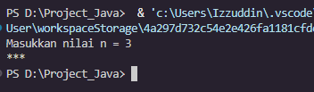
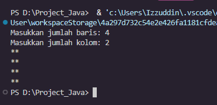
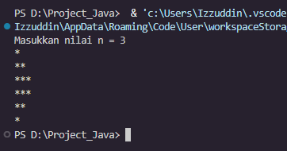
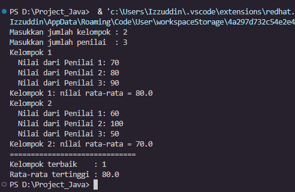
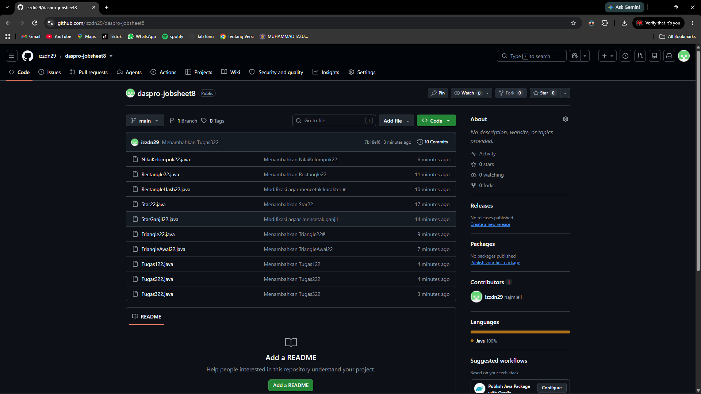
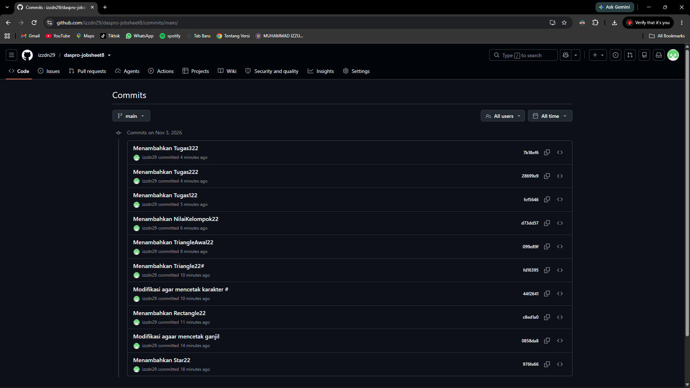
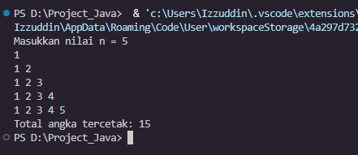
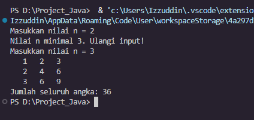
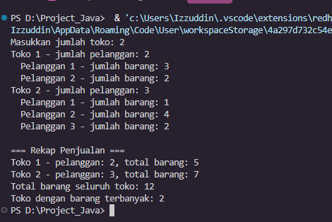

# JOBSHEET 8 - PERULANGAN 2

**Identitas Mahasiswa:**
* **Nama:** Muhammad Izzuddin Nur N.
* **NIM:** 264107020245
* **Kelas / No. Presensi:** 1I / 22

---

## 1: TUJUAN PRAKTIKUM

1. Mahasiswa memahami konsep perulangan bersarang pada algoritma.
2. Mahasiswa memahami alur perulangan bersarang.
3. Mahasiswa mengenal sintaks perulangan bersarang.
4. Mahasiswa mampu menerapkan perulangan bersarang untuk menyelesaikan studi kasus sederhana.

---

## 2: HASIL PERCOBAAN & ANALISIS


### 2.1 Percobaan 1: Review Perulangan 1

Program mencetak karakter `*` sebanyak `n` kali secara mendatar menggunakan `for`.

#### 2.1.1 Kode Program Java
```java
// Star22.java
import java.util.Scanner;

public class Star22 {
    public static void main(String[] args) {
        Scanner sc = new Scanner(System.in);
        System.out.print("Masukkan nilai n = ");
        int n = sc.nextInt();

        for (int i = 1; i <= n; i++) {
            System.out.print("*");
        }
        System.out.println();
        sc.close();
    }
}
```

#### 2.1.2 Hasil Running / Screenshot Output



n = 5:
```
Masukkan nilai n = 5
*****
```
n = 3:
```
Masukkan nilai n = 3
***
```
n = 7:
```
Masukkan nilai n = 7
*******
```

Jumlah karakter `*` sama dengan nilai `n`: 5, 3, dan 7 karakter.

#### 2.1.3 Jawaban Pertanyaan
* **Pertanyaan 1:** Jika `i = 1` diubah menjadi `i = 0` tanpa mengubah kondisi, berapa karakter `*` yang tercetak saat n = 5?
  * **Jawab:** 6 karakter. Nilai `i` yang dijalankan adalah 0, 1, 2, 3, 4, 5, sehingga loop berputar satu kali lebih banyak.
* **Pertanyaan 2:** Jika kondisi `i <= n` diganti `i < n`, berapa kali perulangan dijalankan saat n = 5?
  * **Jawab:** 4 kali (`i` = 1 sampai 4). Operator `<` tidak menyertakan `i = n`, sedangkan `<=` menyertakannya.
* **Pertanyaan 3:** Prediksi output `for (int i = 2; i <= n; i += 2)` saat n = 9, lalu buktikan. Modifikasi agar mencetak bilangan ganjil positif ≤ n.
  * **Jawab:** Prediksi: `2 4 6 8` (bilangan genap, karena `i` mulai 2 dan naik 2). Terbukti pada output di bawah. Agar mencetak ganjil, inisialisasi diubah menjadi `i = 1`.

```java
// StarGanjil22.java
import java.util.Scanner;

// Pertanyaan 3: potongan kode i = 2; i += 2 dimodifikasi menjadi bilangan ganjil positif <= n
public class StarGanjil22 {
    public static void main(String[] args) {
        Scanner sc = new Scanner(System.in);
        System.out.print("Masukkan nilai n = ");
        int n = sc.nextInt();

        // Kode asli (bilangan genap)
        System.out.print("Genap : ");
        for (int i = 2; i <= n; i += 2) {
            System.out.print(i + " ");
        }
        System.out.println();

        // Modifikasi (bilangan ganjil)
        System.out.print("Ganjil: ");
        for (int i = 1; i <= n; i += 2) {
            System.out.print(i + " ");
        }
        System.out.println();
        sc.close();
    }
}
```
```
Masukkan nilai n = 9
Genap : 2 4 6 8 
Ganjil: 1 3 5 7 9 
```
* **Pertanyaan 4:** Mengapa `i++` diganti `i--` (kondisi tetap `i <= n`) membuat perulangan tidak berhenti dalam waktu wajar?
  * **Jawab:** `i` dimulai dari 1 lalu terus turun (0, -1, -2, ...), sehingga `i <= n` selalu `true` dan kondisi berhenti tidak pernah tercapai. Perulangan baru berhenti jika `i` mengalami *overflow* setelah miliaran iterasi.

---

### 2.2 Percobaan 2: Pola Bintang Persegi Panjang (Nested FOR)

Program mencetak persegi panjang bintang. *Outer loop* mengatur baris, *inner loop* mengatur kolom.

#### 2.2.1 Kode Program Java
```java
// Rectangle22.java
import java.util.Scanner;

public class Rectangle22 {
    public static void main(String[] args) {
        Scanner sc = new Scanner(System.in);
        System.out.print("Masukkan jumlah baris: ");
        int baris = sc.nextInt();
        System.out.print("Masukkan jumlah kolom: ");
        int kolom = sc.nextInt();

        for (int i = 1; i <= baris; i++) {          // outer loop: baris
            for (int j = 1; j <= kolom; j++) {      // inner loop: kolom
                System.out.print("*");
            }
            System.out.println();                   // pindah baris
        }
        sc.close();
    }
}
```

#### 2.2.2 Hasil Running / Screenshot Output



Baris = 3, kolom = 6:
```
Masukkan jumlah baris: 3
Masukkan jumlah kolom: 6
******
******
******
```
Baris = 4, kolom = 2:
```
Masukkan jumlah baris: 4
Masukkan jumlah kolom: 2
**
**
**
**
```
Baris = 1, kolom = 5:
```
Masukkan jumlah baris: 1
Masukkan jumlah kolom: 5
*****
```

Jumlah baris mengikuti input baris, dan jumlah bintang per baris mengikuti input kolom.

#### 2.2.3 Jawaban Pertanyaan
* **Pertanyaan 1:** Fungsi variabel `i` dan `j`.
  * **Jawab:** `i` penghitung baris pada *outer loop*. `j` penghitung kolom (jumlah bintang per baris) pada *inner loop*.
* **Pertanyaan 2:** Berapa kali *outer loop*, *inner loop*, dan `print("*")` dijalankan untuk baris = 4 dan kolom = 7?
  * **Jawab:**

    | Bagian | Jumlah eksekusi |
    | :--- | :---: |
    | Outer loop | 4 kali |
    | Inner loop | 4 × 7 = 28 putaran (7 putaran per baris) |
    | `print("*")` | 28 kali |
* **Pertanyaan 3:** Apa yang terjadi jika batas *outer* dan *inner* ditukar (baris = 3, kolom = 6)?
  * **Jawab:** *Outer loop* berjalan 6 kali dan *inner loop* 3 kali, sehingga tercetak 6 baris dengan 3 bintang per baris (bentuk tertukar dari 3 × 6 menjadi 6 × 3).
```
Masukkan jumlah baris: 3
Masukkan jumlah kolom: 6
***
***
***
***
***
***
```
* **Pertanyaan 4:** Akibat penghapusan `System.out.println();` setelah *inner loop*.
  * **Jawab:** Kursor tidak pindah baris, sehingga seluruh bintang (3 × 6 = 18) tercetak dalam satu baris.
```
Masukkan jumlah baris: 3
Masukkan jumlah kolom: 6
******************
```
* **Pertanyaan 5:** Modifikasi agar karakter yang dicetak adalah `#`, lalu *commit* dan *push*.
  * **Jawab:** Argumen `print("*")` diganti `print("#")` (file `RectangleHash22.java`). *Commit* dan *push* lihat bagian 2.5.

```java
// RectangleHash22.java
import java.util.Scanner;

// Pertanyaan 5: karakter yang dicetak diubah menjadi #
public class RectangleHash22 {
    public static void main(String[] args) {
        Scanner sc = new Scanner(System.in);
        System.out.print("Masukkan jumlah baris: ");
        int baris = sc.nextInt();
        System.out.print("Masukkan jumlah kolom: ");
        int kolom = sc.nextInt();

        for (int i = 1; i <= baris; i++) {
            for (int j = 1; j <= kolom; j++) {
                System.out.print("#");
            }
            System.out.println();
        }
        sc.close();
    }
}
```
```
Masukkan jumlah baris: 3
Masukkan jumlah kolom: 6
######
######
######
```

---

### 2.3 Percobaan 3: Debugging Bintang Segitiga – Nested WHILE

Kode awal sengaja salah. Kesalahan dicari dengan baris *debug*, lalu diperbaiki tanpa mengganti `while` menjadi `for`.

#### 2.3.1 Kode Program Java

Kode awal beserta baris *debug* sementara (langkah 4):
```java
// TriangleAwal22.java
import java.util.Scanner;

// Kode awal (sengaja salah) dari jobsheet, dengan baris debug sementara (langkah 4)
public class TriangleAwal22 {
    public static void main(String[] args) {
        Scanner sc = new Scanner(System.in);
        System.out.print("Masukkan nilai n = ");
        int n = sc.nextInt();

        int i = 0;
        while (i <= n) {
            System.out.print("[i=" + i + "] "); // debug sementara
            int j = 0;
            while (j < i) {
                System.out.print("*");
                j++;
            }
            i++;
        }
        sc.close();
    }
}
```

Kode akhir setelah perbaikan (baris *debug* dihapus) dan ditambah segitiga terbalik (langkah 8):
```java
// Triangle22.java
import java.util.Scanner;

public class Triangle22 {
    public static void main(String[] args) {
        Scanner sc = new Scanner(System.in);
        System.out.print("Masukkan nilai n = ");
        int n = sc.nextInt();

        // Segitiga bertingkat
        int i = 1;
        while (i <= n) {
            int j = 0;
            while (j < i) {
                System.out.print("*");
                j++;
            }
            System.out.println();
            i++;
        }

        // Segitiga terbalik
        i = n;
        while (i >= 1) {
            int j = 0;
            while (j < i) {
                System.out.print("*");
                j++;
            }
            System.out.println();
            i--;
        }
        sc.close();
    }
}
```

#### 2.3.2 Hasil Running / Screenshot Output



Output kode awal (tanpa *debug*):

n = 3:
```
Masukkan nilai n = 3
******
```
n = 5:
```
Masukkan nilai n = 5
***************
```

Output kode awal dengan baris *debug*, n = 5:
```
Masukkan nilai n = 5
[i=0] [i=1] *[i=2] **[i=3] ***[i=4] ****[i=5] *****
```

Setelah perbaikan 6a (`println()` ditambahkan, `i` masih mulai dari 0), n = 5:
```
Masukkan nilai n = 5

*
**
***
****
*****
```

Setelah perbaikan 6b (inisialisasi `i = 1`) dan penambahan segitiga terbalik, n = 5:
```
Masukkan nilai n = 5
*
**
***
****
*****
*****
****
***
**
*
```

Hasil pengamatan langkah 5:
* **a.** *Outer loop* dijalankan 6 kali (`i` = 0 sampai 5). Tidak sama dengan jumlah baris yang diinginkan (5).
* **b.** Saat `i = 0` tercetak 0 karakter `*`.
* **c.** Karena belum ada `System.out.println()`, kursor tidak pernah pindah baris.

Hasil pengamatan langkah 6a: masih ada satu baris kosong di awal (saat `i = 0`).

#### 2.3.3 Jawaban Pertanyaan
* **Pertanyaan 1:** Ketidaksesuaian output awal dan minimal dua perbaikan.
  * **Jawab:** Output awal: semua bintang dalam satu baris (6 bintang untuk n = 3 dan 15 untuk n = 5) dengan 6 putaran luar (ada putaran kosong pada `i = 0`). Perbaikan:
    1. Tambahkan `System.out.println();` setelah *inner loop*, sebelum `i++`.
    2. Ubah inisialisasi *outer loop* menjadi `int i = 1;` agar berjalan tepat n kali tanpa baris kosong.
* **Pertanyaan 2:** Peran `i` dan `j`. Mengapa `j` harus di-*reset* ke 0 pada setiap iterasi *outer loop*? Apa yang terjadi jika tidak?
  * **Jawab:** `i` adalah nomor baris sekaligus jumlah bintang pada baris tersebut. `j` adalah penghitung bintang yang sudah dicetak pada baris berjalan. `j` di-*reset* agar setiap baris mulai menghitung dari 0. Jika tidak, `j` masih bernilai `i` dari baris sebelumnya, sehingga setiap baris berikutnya hanya mencetak 1 bintang dan segitiga tidak terbentuk.
* **Pertanyaan 3:** Perubahan inisialisasi, kondisi, dan *update* pada *outer loop* untuk segitiga terbalik.
  * **Jawab:**

    | Komponen | Segitiga bertingkat | Segitiga terbalik |
    | :--- | :--- | :--- |
    | Inisialisasi | `i = 1` | `i = n` |
    | Kondisi | `i <= n` | `i >= 1` |
    | Update | `i++` | `i--` |

---

### 2.4 Percobaan 4: Studi Kasus Nilai Tugas Proyek Kelompok

Program menghitung rata-rata nilai tiap kelompok dan menentukan kelompok dengan rata-rata tertinggi. Struktur: `while` (kelompok), `for` (penilai), `do-while` (validasi nilai 0–100).

#### 2.4.1 Kode Program Java
```java
// NilaiKelompok22.java
import java.util.Scanner;

public class NilaiKelompok22 {
    public static void main(String[] args) {
        Scanner sc = new Scanner(System.in);

        System.out.print("Masukkan jumlah kelompok : ");
        int jumlahKelompok = sc.nextInt();
        System.out.print("Masukkan jumlah penilai  : ");
        int jumlahPenilai = sc.nextInt();

        if (jumlahKelompok <= 0 || jumlahPenilai <= 0) {
            System.out.println("Jumlah kelompok dan penilai harus > 0.");
        } else {
            int nomorKelompok = 1;        // penghitung outer loop
            double rataTertinggi = -1;    // -1 agar kelompok pertama pasti tercatat
            int kelompokTerbaik = 0;

            // Outer loop (WHILE): kelompok
            while (nomorKelompok <= jumlahKelompok) {
                System.out.println("Kelompok " + nomorKelompok);
                double totalNilai = 0;

                // Inner loop (FOR): penilai
                for (int j = 1; j <= jumlahPenilai; j++) {
                    int nilai;
                    // Innermost loop (DO-WHILE): ulangi input tidak valid
                    do {
                        System.out.print("  Nilai dari Penilai " + j + ": ");
                        nilai = sc.nextInt();
                        if (nilai < 0 || nilai > 100) {
                            System.out.println("  Nilai harus 0-100. Ulangi input!");
                        }
                    } while (nilai < 0 || nilai > 100);
                    totalNilai += nilai;
                }

                double rataNilai = totalNilai / jumlahPenilai;
                System.out.println("Kelompok " + nomorKelompok
                        + ": nilai rata-rata = " + rataNilai);

                if (rataNilai > rataTertinggi) {
                    rataTertinggi = rataNilai;
                    kelompokTerbaik = nomorKelompok;
                }

                nomorKelompok++;
            }

            System.out.println("==============================");
            System.out.println("Kelompok terbaik    : " + kelompokTerbaik);
            System.out.println("Rata-rata tertinggi : " + rataTertinggi);
        }
        sc.close();
    }
}
```

#### 2.4.2 Hasil Running / Screenshot Output



3 kelompok, 2 penilai, dengan input tidak valid (105):
```
Masukkan jumlah kelompok : 3
Masukkan jumlah penilai  : 2
Kelompok 1
  Nilai dari Penilai 1: 80
  Nilai dari Penilai 2: 90
Kelompok 1: nilai rata-rata = 85.0
Kelompok 2
  Nilai dari Penilai 1: 75
  Nilai dari Penilai 2: 105
  Nilai harus 0-100. Ulangi input!
  Nilai dari Penilai 2: 85
Kelompok 2: nilai rata-rata = 80.0
Kelompok 3
  Nilai dari Penilai 1: 90
  Nilai dari Penilai 2: 96
Kelompok 3: nilai rata-rata = 93.0
==============================
Kelompok terbaik    : 3
Rata-rata tertinggi : 93.0
```
2 kelompok, 3 penilai:
```
Masukkan jumlah kelompok : 2
Masukkan jumlah penilai  : 3
Kelompok 1
  Nilai dari Penilai 1: 70
  Nilai dari Penilai 2: 80
  Nilai dari Penilai 3: 90
Kelompok 1: nilai rata-rata = 80.0
Kelompok 2
  Nilai dari Penilai 1: 60
  Nilai dari Penilai 2: 100
  Nilai dari Penilai 3: 50
Kelompok 2: nilai rata-rata = 70.0
==============================
Kelompok terbaik    : 1
Rata-rata tertinggi : 80.0
```
Input tidak valid (jumlah kelompok = 0):
```
Masukkan jumlah kelompok : 0
Masukkan jumlah penilai  : 2
Jumlah kelompok dan penilai harus > 0.
```

#### 2.4.3 Jawaban Pertanyaan
* **Pertanyaan 1:** Mengapa `totalNilai` di-*reset* di dalam *outer loop*, tetapi `rataTertinggi` tidak?
  * **Jawab:** Setiap kelompok punya total sendiri, sehingga tanpa *reset* nilai kelompok sebelumnya ikut terjumlah. `rataTertinggi` harus bertahan sepanjang semua kelompok karena menjadi pembanding. Jika di-*reset*, hasil kelompok sebelumnya hilang.
* **Pertanyaan 2:** Untuk 3 kelompok dan 2 penilai, berapa kali badan perulangan FOR dijalankan?
  * **Jawab:** 3 × 2 = 6 kali.
* **Pertanyaan 3:** Apa yang terjadi jika `totalNilai` bertipe `int` dan rata-rata memakai pembagian dua bilangan bulat?
  * **Jawab:** Hasil pembagian dibulatkan ke bawah (bagian desimal hilang). Contoh: nilai 85 dan 90, total 175, `175 / 2` = 87 (bukan 87.5).
* **Pertanyaan 4:** Mengapa `rataTertinggi` bernilai awal -1, bukan 0?
  * **Jawab:** Agar kelompok pertama selalu tercatat, sebab rata-rata minimal adalah 0 dan 0 > -1. Jika awalnya 0, kondisi `rataNilai > rataTertinggi` salah ketika rata-rata 0. Contoh: 1 kelompok, 2 penilai, nilai 0 dan 0. Hasilnya `Kelompok terbaik : 0` (seharusnya 1).
* **Pertanyaan 5:** Jenis dan peran tiga tingkat perulangan.
  * **Jawab:**

    | Tingkat | Jenis | Peran |
    | :--- | :--- | :--- |
    | Luar | `while` | Memproses kelompok satu per satu. |
    | Tengah | `for` | Memasukkan nilai dari setiap penilai. |
    | Dalam | `do-while` | Mengulang input nilai selama di luar rentang 0–100. |

---

### 2.5 Bukti Commit dan Push ke GitHub

Repository: `daspro-jobsheet8`





---

## 3: TUGAS MANDIRI

- [x] **Tugas 1:** Pola bilangan bertingkat (`Tugas122.java`).
- [x] **Tugas 2:** Tabel perkalian n × n (`Tugas222.java`).
- [x] **Tugas 3:** Rekap penjualan beberapa toko (`Tugas322.java`).

### 3.1 Implementasi Kode Tugas

**Tugas 1 - Pola Bilangan Bertingkat**

Baris ke-i mencetak angka 1 sampai i. Variabel `total` dihitung setiap angka dicetak. Input n < 1 diminta ulang.

```java
// Tugas122.java
import java.util.Scanner;

public class Tugas122 {
    public static void main(String[] args) {
        Scanner sc = new Scanner(System.in);

        int n;
        do {
            System.out.print("Masukkan nilai n = ");
            n = sc.nextInt();
            if (n < 1) {
                System.out.println("Nilai n minimal 1. Ulangi input!");
            }
        } while (n < 1);

        int total = 0;
        for (int i = 1; i <= n; i++) {
            for (int j = 1; j <= i; j++) {
                System.out.print(j);
                if (j < i) {
                    System.out.print(" ");
                }
                total++;
            }
            System.out.println();
        }
        System.out.println("Total angka tercetak: " + total);
        sc.close();
    }
}
```

Skenario pengujian Tugas 1:

| No | Input n | Hasil |
| :---: | :---: | :--- |
| 1 | `5` | 5 baris pola, total angka 15 |
| 2 | `0` | Ditolak, diminta input ulang |
| 3 | `3` | 3 baris pola, total angka 6 |

Hasil running Tugas 1



```
Masukkan nilai n = 5
1
1 2
1 2 3
1 2 3 4
1 2 3 4 5
Total angka tercetak: 15
```
Input tidak valid:
```
Masukkan nilai n = 0
Nilai n minimal 1. Ulangi input!
Masukkan nilai n = 3
1
1 2
1 2 3
Total angka tercetak: 6
```

**Tugas 2 - Tabel Perkalian**

Nested `for`: baris `i` dan kolom `j`, setiap sel bernilai `i * j` dengan lebar 4 karakter (`%4d`). Seluruh nilai dijumlahkan ke `jumlah`. Input n < 3 diminta ulang.

```java
// Tugas222.java
import java.util.Scanner;

public class Tugas222 {
    public static void main(String[] args) {
        Scanner sc = new Scanner(System.in);

        int n;
        do {
            System.out.print("Masukkan nilai n = ");
            n = sc.nextInt();
            if (n < 3) {
                System.out.println("Nilai n minimal 3. Ulangi input!");
            }
        } while (n < 3);

        int jumlah = 0;
        for (int i = 1; i <= n; i++) {          // baris
            for (int j = 1; j <= n; j++) {      // kolom
                int hasil = i * j;
                System.out.printf("%4d", hasil);
                jumlah += hasil;
            }
            System.out.println();
        }
        System.out.println("Jumlah seluruh angka: " + jumlah);
        sc.close();
    }
}
```

Skenario pengujian Tugas 2:

| No | Input n | Hasil |
| :---: | :---: | :--- |
| 1 | `4` | Tabel 4 × 4, jumlah 100 |
| 2 | `2` | Ditolak (minimal 3), diminta input ulang |
| 3 | `3` | Tabel 3 × 3, jumlah 36 |

Hasil running Tugas 2



```
Masukkan nilai n = 4
   1   2   3   4
   2   4   6   8
   3   6   9  12
   4   8  12  16
Jumlah seluruh angka: 100
```
Input tidak valid:
```
Masukkan nilai n = 2
Nilai n minimal 3. Ulangi input!
Masukkan nilai n = 3
   1   2   3
   2   4   6
   3   6   9
Jumlah seluruh angka: 36
```

**Tugas 3 - Rekap Penjualan Beberapa Toko**

*Outer loop* (`for`) untuk toko dan *inner loop* (`for`) untuk pelanggan. Total barang diakumulasikan ke `totalBarangToko` dan `totalSeluruh`. Toko terbanyak dipilih dengan operator `>` sehingga jika nilai sama, nomor toko terkecil tetap terpilih. Input negatif diminta ulang dengan `do-while`.

```java
// Tugas322.java
import java.util.Scanner;

public class Tugas322 {
    public static void main(String[] args) {
        Scanner sc = new Scanner(System.in);

        int jumlahToko;
        do {
            System.out.print("Masukkan jumlah toko: ");
            jumlahToko = sc.nextInt();
            if (jumlahToko < 1) {
                System.out.println("Jumlah toko minimal 1. Ulangi input!");
            }
        } while (jumlahToko < 1);

        int totalSeluruh = 0;
        int tokoTerbanyak = 0;
        int barangTerbanyak = -1;   // -1 agar toko pertama pasti tercatat

        // Rekap per toko disimpan sementara sebagai teks agar tampil di ringkasan akhir
        String rekap = "";

        for (int t = 1; t <= jumlahToko; t++) {
            int jumlahPelanggan;
            do {
                System.out.print("Toko " + t + " - jumlah pelanggan: ");
                jumlahPelanggan = sc.nextInt();
                if (jumlahPelanggan < 0) {
                    System.out.println("Tidak boleh negatif. Ulangi input!");
                }
            } while (jumlahPelanggan < 0);

            int totalBarangToko = 0;
            for (int p = 1; p <= jumlahPelanggan; p++) {
                int barang;
                do {
                    System.out.print("  Pelanggan " + p + " - jumlah barang: ");
                    barang = sc.nextInt();
                    if (barang < 0) {
                        System.out.println("  Tidak boleh negatif. Ulangi input!");
                    }
                } while (barang < 0);
                totalBarangToko += barang;
            }

            rekap += "Toko " + t + " - pelanggan: " + jumlahPelanggan
                    + ", total barang: " + totalBarangToko + "\n";
            totalSeluruh += totalBarangToko;

            if (totalBarangToko > barangTerbanyak) {   // '>' : nomor toko terkecil menang jika sama
                barangTerbanyak = totalBarangToko;
                tokoTerbanyak = t;
            }
        }

        System.out.println();
        System.out.println("=== Rekap Penjualan ===");
        System.out.print(rekap);
        System.out.println("Total barang seluruh toko: " + totalSeluruh);
        System.out.println("Toko dengan barang terbanyak: " + tokoTerbanyak);
        sc.close();
    }
}
```

Skenario pengujian Tugas 3:

| No | Skenario | Hasil |
| :---: | :--- | :--- |
| 1 | Contoh jobsheet (Toko 1: 3, 2 barang; Toko 2: 1, 4, 2 barang) | Total 12, toko terbanyak 2 |
| 2 | Ada toko tanpa pelanggan (0 pelanggan) | Total barang toko = 0, tetap diproses |
| 3 | Nilai tertinggi sama (5 dan 5) | Toko terbanyak = 1 (nomor terkecil) |
| 4 | Input negatif | Ditolak, diminta input ulang |

Hasil running Tugas 3



Contoh jobsheet:
```
Masukkan jumlah toko: 2
Toko 1 - jumlah pelanggan: 2
  Pelanggan 1 - jumlah barang: 3
  Pelanggan 2 - jumlah barang: 2
Toko 2 - jumlah pelanggan: 3
  Pelanggan 1 - jumlah barang: 1
  Pelanggan 2 - jumlah barang: 4
  Pelanggan 3 - jumlah barang: 2

=== Rekap Penjualan ===
Toko 1 - pelanggan: 2, total barang: 5
Toko 2 - pelanggan: 3, total barang: 7
Total barang seluruh toko: 12
Toko dengan barang terbanyak: 2
```
Ada toko tanpa pelanggan:
```
Masukkan jumlah toko: 3
Toko 1 - jumlah pelanggan: 1
  Pelanggan 1 - jumlah barang: 4
Toko 2 - jumlah pelanggan: 0
Toko 3 - jumlah pelanggan: 2
  Pelanggan 1 - jumlah barang: 2
  Pelanggan 2 - jumlah barang: 2

=== Rekap Penjualan ===
Toko 1 - pelanggan: 1, total barang: 4
Toko 2 - pelanggan: 0, total barang: 0
Toko 3 - pelanggan: 2, total barang: 4
Total barang seluruh toko: 8
Toko dengan barang terbanyak: 1
```
Nilai tertinggi sama:
```
Masukkan jumlah toko: 2
Toko 1 - jumlah pelanggan: 1
  Pelanggan 1 - jumlah barang: 5
Toko 2 - jumlah pelanggan: 1
  Pelanggan 1 - jumlah barang: 5

=== Rekap Penjualan ===
Toko 1 - pelanggan: 1, total barang: 5
Toko 2 - pelanggan: 1, total barang: 5
Total barang seluruh toko: 10
Toko dengan barang terbanyak: 1
```
Input negatif:
```
Masukkan jumlah toko: 0
Jumlah toko minimal 1. Ulangi input!
Masukkan jumlah toko: 1
Toko 1 - jumlah pelanggan: -1
Tidak boleh negatif. Ulangi input!
Toko 1 - jumlah pelanggan: 1
  Pelanggan 1 - jumlah barang: -2
  Tidak boleh negatif. Ulangi input!
  Pelanggan 1 - jumlah barang: 3

=== Rekap Penjualan ===
Toko 1 - pelanggan: 1, total barang: 3
Total barang seluruh toko: 3
Toko dengan barang terbanyak: 1
```

---

## 4: KESIMPULAN

Perulangan bersarang menjalankan *inner loop* sepenuhnya pada setiap putaran *outer loop*, sehingga total eksekusi adalah hasil kali kedua batas (misalnya 4 × 7 = 28). Variabel penghitung *inner loop* harus di-*reset* pada setiap putaran luar, sedangkan variabel penampung hasil keseluruhan (seperti `rataTertinggi`) tidak boleh di-*reset*. Inisialisasi, kondisi, dan *update* yang tepat menentukan jumlah putaran dan pola yang terbentuk, seperti persegi panjang, segitiga, tabel perkalian, dan rekap data bertingkat.
